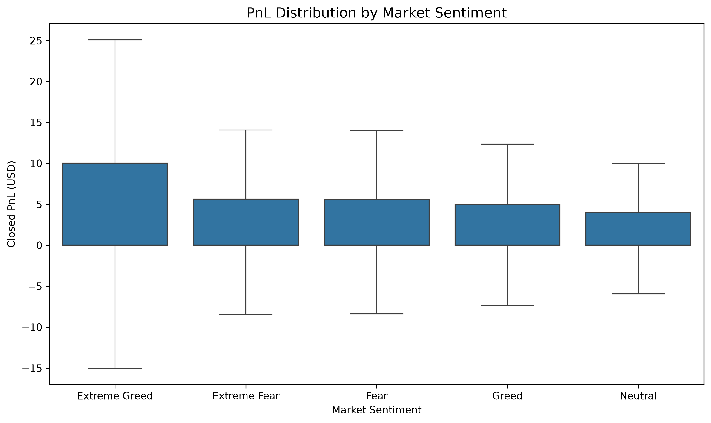
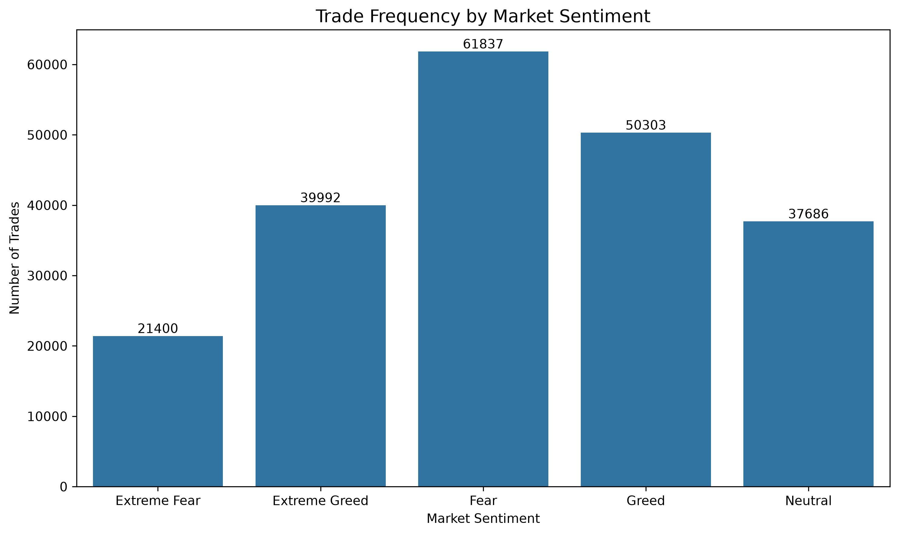
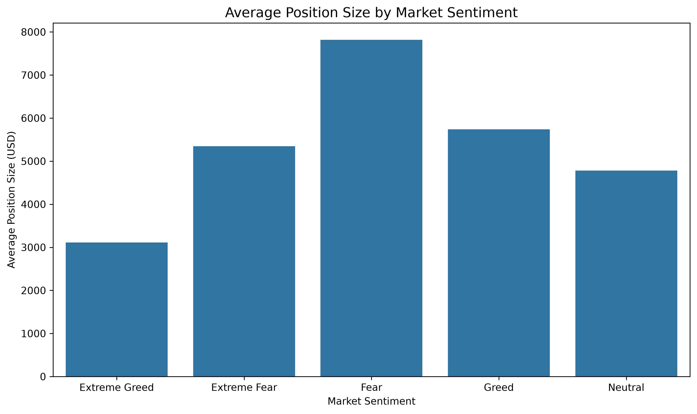
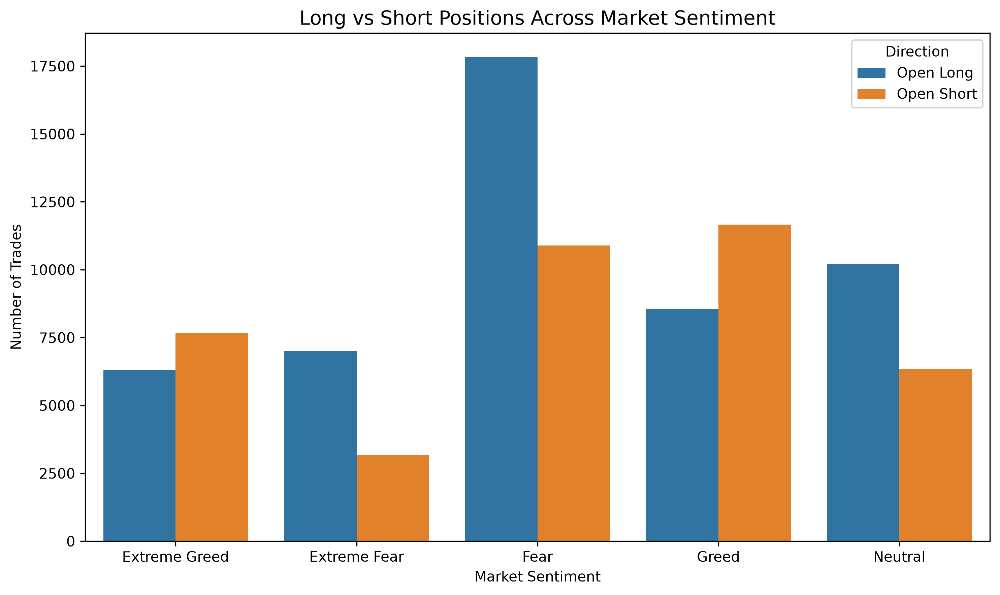
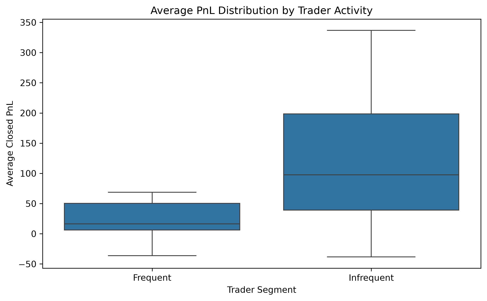
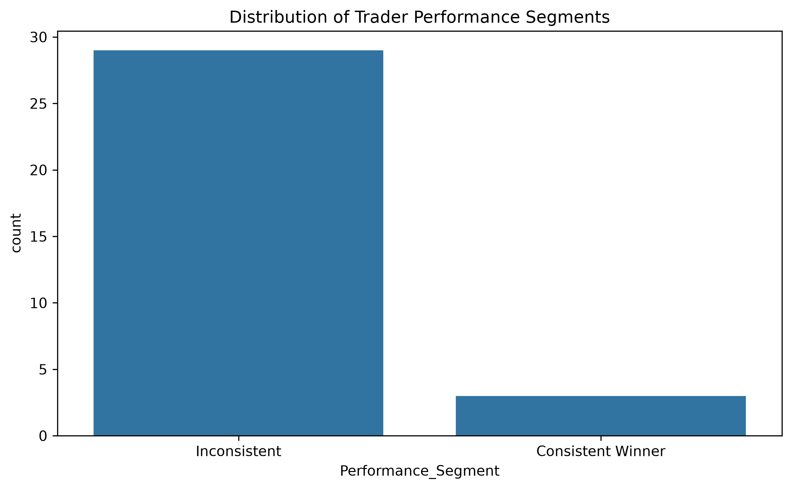

# Trader Performance vs Market Sentiment

An exploratory data analysis project investigating the relationship between Bitcoin market sentiment and trader performance and behaviour using the Fear & Greed Index and Hyperliquid historical trading data.

## Project Overview

Market sentiment can provide useful context for understanding trading decisions. This project explores how trader performance and trading behaviour vary across different market sentiment conditions.

The analysis combines the Bitcoin Fear & Greed Index with historical trading data from Hyperliquid to investigate patterns in profitability, trading frequency, position sizing, directional bias, and trader performance segments.

## Objectives

- Examine trader profitability across different market sentiment categories.
- Compare trading frequency and average position size during Fear and Greed periods.
- Analyze Long and Short trading behaviour.
- Segment traders based on activity and win rate.
- Derive practical observations and strategy recommendations from the findings.

## Technologies Used

- Python
- Pandas
- NumPy
- Matplotlib
- Seaborn
- Jupyter Notebook

## Project Structure

```text
Trader-Performance-vs-Market-Sentiment/
│
├── charts/
│   ├── long_vs_short.png
│   ├── performance_segments.png
│   ├── pnl_distribution.png
│   ├── position_size.png
│   ├── trade_frequency.png
│   └── trader_activity.png
│
├── data/
│   ├── fear_greed_index.csv
│   └── historical_data.csv
│
├── notebooks/
│   └── Trader_Performance_vs_Sentiment.ipynb
│
├── README.md
└── requirements.txt
```

## Analysis Workflow

### 1. Data Preparation

- Loaded and inspected both datasets.
- Checked data types, missing values, and duplicate records.
- Standardized date formats.
- Merged trading records with the Fear & Greed Index using the trading date.

### 2. Feature Engineering

Created additional metrics for the analysis:

- **Profit:** Identifies profitable trades using Closed PnL.
- **Trade_Date:** Standardized trading date.
- **Trade_Size:** Uses trade value in USD.

### 3. Trader Performance Analysis

Compared performance across five sentiment categories:

- Extreme Fear
- Fear
- Neutral
- Greed
- Extreme Greed

Metrics included average PnL, median PnL, win rate, trade count, and a cumulative negative PnL measure used as a drawdown proxy.

### 4. Trader Behaviour Analysis

Investigated:

- Trade frequency across sentiment categories.
- Average position size.
- Long vs Short trading behaviour.

### 5. Trader Segmentation

Segmented traders into:

- Frequent vs Infrequent traders, based on median trading activity.
- Consistent Winners vs Inconsistent traders, based on a 50% win-rate threshold.

## Key Findings

### Performance and Market Sentiment

- Extreme Greed periods recorded the highest average PnL (**$67.89**) and highest win rate (**46%**).
- Fear periods also showed relatively high average PnL (**$54.29**).
- Greed periods recorded the largest cumulative negative PnL (**-$1,058,685.92**), used as a drawdown proxy.
- Median PnL remained zero across sentiment categories, suggesting that larger trade outcomes had a substantial influence on average PnL.

### Trader Behaviour

- Fear periods recorded the highest trading activity, with **61,837 trades**.
- Extreme Fear periods recorded the lowest activity, with **21,400 trades**.
- Fear periods had the largest average position size (**$7,816.11**).
- Extreme Greed periods had the smallest average position size (**$3,112.25**).
- Long and Short position counts varied across sentiment categories.

### Trader Segmentation

- Frequent traders averaged **11,684.81 trades**, while Infrequent traders averaged **1,516.69 trades**.
- Infrequent traders recorded a higher average PnL (**$137.80**) than Frequent traders (**$57.58**).
- Only **3 out of 32 traders** achieved a win rate of at least 50%.

These observations suggest that higher trading frequency does not necessarily correspond to higher average profitability.

## Visualizations

### PnL Distribution by Market Sentiment



### Trade Frequency by Market Sentiment



### Average Position Size by Market Sentiment



### Long vs Short Positions



### Average PnL by Trader Activity



### Trader Performance Segments



## Strategy Recommendations

**1. Increase position selectivity during Fear periods**

Fear periods showed the highest trading activity and largest average position sizes. Prioritizing high-confidence setups and maintaining disciplined position sizing may help manage unnecessary exposure.

**2. Focus on trade quality instead of trade quantity**

Infrequent traders recorded higher average PnL than Frequent traders. Trade selection and risk management may therefore deserve more attention than simply increasing trading frequency.

## Limitations

- The analysis identifies associations and patterns; it does not establish that market sentiment causes changes in trader performance.
- The cumulative negative PnL measure is a drawdown proxy, not a conventional maximum drawdown calculation.
- Leverage was excluded because the recorded values contained unrealistic magnitudes and could not be reliably interpreted.
- Results are based on the available datasets and analysis period.

## How to Run

1. Clone or download this repository.
2. Open a terminal in the project directory.
3. Install the required packages:

```bash
pip install -r requirements.txt
```

4. Launch Jupyter Notebook:

```bash
jupyter notebook
```

5. Open:

```text
notebooks/Trader_Performance_vs_Sentiment.ipynb
```

6. Run the notebook cells sequentially.

## Conclusion

This project explores how Bitcoin market sentiment relates to trader performance and trading behaviour on Hyperliquid.

The analysis found differences in profitability, trading activity, position sizing, and trader segmentation across sentiment categories. It also showed that higher trading frequency did not necessarily translate into higher average PnL.

Overall, the findings highlight the value of combining market sentiment with trading data to better understand trading patterns and risk management.

---

*This project was completed as part of the PrimeTrade.ai Round 0 assignment. The analysis is for educational and analytical purposes only and does not constitute financial advice.*
